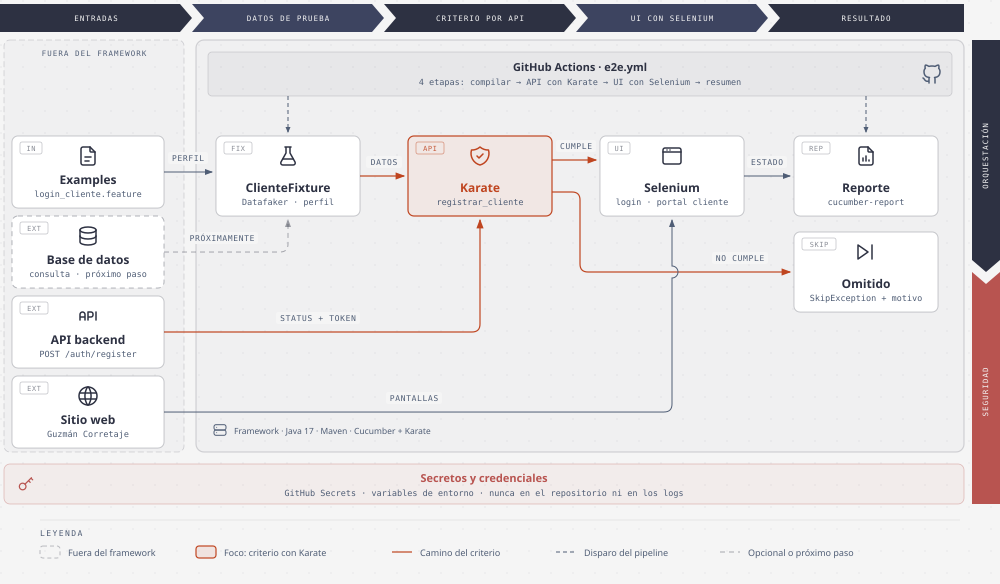

# Guzmán Corretaje — Selenium + Cucumber con fixtures de datos en Karate

> **Rama `feature/karate-fixtures`** · Todo lo de [`main`](https://github.com/pgp-qa-automation-labs/poc-selenium-cucumber/tree/main) + **fixtures que preparan los datos de prueba con Karate** antes de que el escenario de Selenium se ejecute. Es una prueba de concepto de cómo integrar **Karate, Selenium y Java** en el mismo proyecto.

## El patrón que demuestra esta rama

Antes de cada escenario, un **fixture** prepara los datos y decide si el escenario puede ejecutarse:

1. **Obtener datos:** `GeneradorDatos` crea un cliente con Datafaker. *En un proyecto real, aquí va la consulta a la base de datos.*
2. **Validar por API:** Karate (`registrar_cliente.feature`) envía los datos y evalúa un criterio.
3. **¿Cumple el criterio?** Si cumple, el cliente queda en el `TestContext` y el escenario continúa con Selenium. Si no, el escenario queda **omitido** (*skipped*) con el motivo en el reporte.

<picture>
  <source media="(prefers-color-scheme: dark)" srcset="docs/diagramas/fixture-karate-dark.svg">
  
</picture>

- **Karate y Cucumber conviven:** Cucumber ejecuta los features de `src/test/resources/features/` (UI con Selenium) y Karate los de `src/test/resources/karate/` (API). El fixture llama a Karate desde Java con `Runner.runFeature(...)`, le pasa los datos como variables y lee el resultado (`elegible` y `motivo`).
- **La configuración es una sola:** la URL de la API sale de `env_<ambiente>.json` (Java) y se pasa a Karate; no hay un `karate-config.js` paralelo.
- **Omitido no es fallido:** si los datos no cumplen el criterio, el escenario no corre y queda registrado por qué. Si Karate no alcanza a evaluar el criterio (un error técnico), el escenario **falla**, no se omite.
- **Por qué el fixture lo llama un paso y no un hook:** un hook `@Before` se ejecuta antes de los pasos y no puede leer los valores de `Examples`. El paso `Given` sí recibe el perfil de la fila y se lo entrega al fixture.

```gherkin
Scenario Outline: Un cliente <perfil> inicia sesión en el portal
  Given que existe un cliente "<perfil>" que cumple el criterio para iniciar sesión
  When inicia sesión con su usuario y contraseña
  Then ve el portal de clientes con su nombre

  Examples: Clientes que cumplen el criterio
    | perfil                 |
    | que quiere comprar     |
    | que consulta           |
    | que consulta arriendos |

  Examples: Cliente que no cumple el criterio (el escenario se omite)
    | perfil             |
    | sin consentimiento |
```

Resultado: **3 escenarios pasan** (registro por Karate + login por Selenium) y **1 queda omitido** con el motivo que devolvió la API: *HTTP 400 - Debes aceptar la Política de Privacidad para crear tu cuenta*.

**Notas técnicas**
- Se usa **Karate 1.5.2** porque funciona con **Java 17**; Karate 2.x exige Java 21.
- Karate trae **Logback**, por eso esta rama no usa `slf4j-simple`. En `logback-test.xml` los logs de Karate quedan en `WARN`, porque en `DEBUG` imprimen cada request, incluida la contraseña del cliente de prueba.
- El feature de Karate **no lleva `@ignore`**: Karate salta los features con esa etiqueta incluso cuando se invocan desde Java.
- Siguiente paso previsto: agregar la consulta a la base de datos (Supabase) como origen de datos, con un usuario de solo lectura y la credencial en variables de entorno.

## Cómo replicarlo en otro proyecto

Guía para llevar el patrón a un proyecto Selenium + Cucumber + Java existente:

1. **Dependencia de Karate según la versión de Java.** Java 17: `io.karatelabs:karate-core` **1.5.x** · Java 11: **1.4.x** · Karate **2.x exige Java 21**. Se agrega con scope `test`.
2. **Logging.** Karate trae **Logback**. Si el proyecto ya usa otra implementación de SLF4J (`slf4j-simple`, `log4j-slf4j`, …), quita una de las dos para evitar el aviso de *multiple bindings* y logs duplicados.
3. **Separar los features.** Los de UI van donde los lee el runner de Cucumber (`features = "classpath:features"`); los de Karate en otra carpeta (aquí `src/test/resources/karate/`). Así Cucumber no intenta ejecutar los de Karate.
4. **Invocar Karate desde Java.** `Runner.runFeature("classpath:karate/...feature", variables, false)` recibe un `Map` con los datos y devuelve un `Map` con las variables que definió el feature (`* def ...`). El último argumento en `false` evita depender de un `karate-config.js`: la configuración la sigue entregando el framework Java.
5. **Evaluar el criterio sin cortar la ejecución.** En el feature de Karate, calcula el resultado con `* def elegible = ...` y `* def motivo = ...` en vez de `match`, que lanzaría un error. El fixture decide qué hacer con ese resultado.
6. **El fixture lo llama un paso, no un hook.** Un `@Before` no conoce los valores de `Examples`; el `Given` sí. El fixture puede inyectarse en los steps por constructor (PicoContainer) junto con el contexto del escenario.
7. **Omitir vs. fallar.** Si no cumple el criterio, lanza `org.testng.SkipException` (con JUnit 5, `org.opentest4j.TestAbortedException`): Cucumber marca el escenario como omitido. Si Karate no alcanza a evaluar el criterio, lanza un error normal para que el escenario **falle** y no se oculte un problema técnico.
8. **No uses `@ignore`** en los features que invoca el fixture: Karate los salta incluso desde `Runner.runFeature`.
9. **Cuidado con los logs.** En `DEBUG`, Karate imprime cada request y response completos. Si viajan datos sensibles (credenciales, RUT, cuentas), deja `com.intuit.karate` en `WARN` o enmascara esos campos.
10. **Origen de datos real.** Donde aquí está `GeneradorDatos`, va la consulta a la base de datos: idealmente con un **usuario de solo lectura**, sobre una vista con las columnas mínimas, y la credencial en variables de entorno o en el gestor de secretos del CI (nunca en el repositorio).

---

## Lo que viene de `main`

### Escenario base: búsqueda de propiedades

Abre un navegador y hace **exactamente lo que haría un cliente** en el sitio [Guzmán Corretaje](https://guzman-corretaje.vercel.app/), comprobando en cada paso que la página responda como se espera:

1. Entra al home y elige **Comprar**.
2. Filtra por **Departamento**, **Región Metropolitana** y **Ñuñoa**, y presiona **Buscar**.
3. Revisa que el listado tenga resultados y que **todas** las propiedades estén en Ñuñoa.
4. Abre la primera propiedad y verifica que el detalle muestre **el mismo título, ubicación, precio y código** que la tarjeta del listado, además de dormitorios y baños.

Además, prueba el **login de clientes** con los datos que prepara el fixture de Karate (ver [El patrón que demuestra esta rama](#el-patrón-que-demuestra-esta-rama)).

Si algo no se cumple, la prueba falla y deja una **captura de pantalla** del momento exacto del error.

El escenario está escrito en lenguaje de negocio ([`busqueda_propiedad.feature`](src/test/resources/features/busqueda_propiedad.feature)):

```gherkin
Scenario: Buscar un departamento en venta en Ñuñoa y revisar su detalle
  Given que el usuario está en el home de Guzmán Corretaje
  When selecciona la operación "Comprar"
  And filtra por tipo "Departamento", región "Región Metropolitana" y comuna "Ñuñoa"
  And presiona Buscar
  Then ve el listado "Propiedades en Venta" con al menos 1 resultado
  ...
```

## Ramas del repositorio

Cada rama agrega un nivel sobre la anterior:

| Rama | Qué agrega | IA |
|---|---|---|
| [`main`](https://github.com/pgp-qa-automation-labs/poc-selenium-cucumber/tree/main) | Automatización base: Selenium + Cucumber + TestNG con Page Object Model | No |
| [`feature/self-healing-ia`](https://github.com/pgp-qa-automation-labs/poc-selenium-cucumber/tree/feature/self-healing-ia) | **Self-healing:** si un elemento de la página cambia, la IA lo encuentra, la prueba continúa y se propone un PR que corrige el código | Sí (consulta directa) |
| [`feature/agentes-ia`](https://github.com/pgp-qa-automation-labs/poc-selenium-cucumber/tree/feature/agentes-ia) | **Agente de triage:** cuando una prueba falla, un agente investiga la causa y crea un issue en GitHub, Jira o Azure DevOps | Sí (agente) |
| **`feature/karate-fixtures`** (esta) | **Fixtures con Karate:** preparan y validan los datos por API antes del escenario de Selenium; si no cumplen el criterio, el escenario se omite | No |
| [`demo/locator-obsoleto`](https://github.com/pgp-qa-automation-labs/poc-selenium-cucumber/tree/demo/locator-obsoleto) | Rama de demostración del PR automático del self-healing | — |

## Cómo funciona

### Vista general

Qué participa en cada etapa: el perfil de `Examples` entra al fixture, Karate valida los datos contra la API y, según el criterio, Selenium ejecuta el login o el escenario queda omitido. GitHub Actions orquesta la ejecución y los secretos se mantienen fuera del repositorio.

<picture>
  <source media="(prefers-color-scheme: dark)" srcset="docs/diagramas/vista-general-fixture-dark.svg">
  
</picture>

### 1. Flujo de la prueba

Cada paso del escenario pasa por el framework, que busca el elemento en la página (esperando a que aparezca), actúa sobre él y valida el resultado.

<picture>
  <source media="(prefers-color-scheme: dark)" srcset="docs/diagramas/flujo-prueba-fixture-dark.svg">
  
</picture>

- **Esperas explícitas:** el framework espera hasta 10 s a que cada elemento aparezca, en lugar de pausas fijas. Así la prueba es rápida cuando el sitio responde rápido y tolera cuando tarda.
- **El fixture va dentro de un paso:** el `Given` del login llama al fixture con el perfil de la fila de `Examples`. Si no cumple el criterio, los pasos siguientes no se ejecutan y el escenario queda omitido, no fallido.
- **Despertar la API:** el backend de QA corre en un plan gratuito que se duerme. Antes de abrir el navegador se consulta la API hasta que responda, para que la prueba no falle por eso.

### 2. Flujo del pipeline (GitHub Actions)

En esta rama el pipeline **no se ejecuta con cada push** (eso solo ocurre en `main`): se lanza abriendo un PR o a mano desde **Actions → Run workflow**, eligiendo la rama `feature/karate-fixtures`.

El pipeline es la barra superior de la [vista general](#vista-general): prepara Java 17, ejecuta `mvn test` con Chrome sin pantalla y sube el reporte de Cucumber como artefacto. Termina en verde si no hubo fallas; los escenarios omitidos no cuentan como fallas.

## Paso a paso para usarlo

### En tu computador
1. **Instala** [Java 17](https://adoptium.net/), [Maven 3.9+](https://maven.apache.org/download.cgi), [Git](https://git-scm.com/) y Google Chrome. No necesitas descargar ChromeDriver: Selenium lo obtiene solo.
2. **Descarga el proyecto:**
   ```bash
   git clone https://github.com/pgp-qa-automation-labs/poc-selenium-cucumber.git
   cd poc-selenium-cucumber
   ```
3. **Ejecuta las pruebas** (se abrirá Chrome y verás la prueba avanzar sola):
   ```bash
   mvn test
   ```
   El login **registra 3 clientes reales** en el ambiente (usuarios `qa_auto_…`); el cuarto perfil se rechaza a propósito y no crea nada.
4. **Revisa el resultado** abriendo en el navegador `target/cucumber-reports/cucumber.html`. Cada paso aparece en verde (aprobado) o rojo (fallido), con la captura de pantalla si algo falló.

### En GitHub, sin instalar nada
1. Entra a la pestaña **Actions** → **E2E Selenium Cucumber** → **Run workflow** → **Run workflow**.
2. Al terminar, abre la ejecución: verás si pasó (✅) o falló (❌) y en **Artifacts** podrás descargar el reporte.

### Opciones útiles
```bash
mvn test                                    # ambiente qa (por defecto)
mvn test "-Denv=dev"                        # localhost (front :3000, API :5000)
mvn test "-Denv=prod"                       # producción (aún sin URL: falla con mensaje claro)
mvn test "-Dbrowser.headless=true"          # sin abrir ventana del navegador
mvn test "-Dcucumber.filter.tags=@smoke"    # solo la búsqueda
mvn test "-Dcucumber.filter.tags=@login"    # solo el login con el fixture de Karate
```

> En **PowerShell** los argumentos `-D` con punto van **entre comillas**; sin ellas PowerShell los corta y Maven responde *Unknown lifecycle phase*. En Git Bash o CMD funcionan con o sin comillas.

## Configuración

```
src/test/resources/config/
├── config.json               → valores comunes a todos los ambientes
└── environments/
    ├── env_dev.json          → localhost
    ├── env_qa.json           → QA (preproductivo)
    └── env_prod.json         → producción
```

- Los JSON contienen **solo datos**; cada `env_<env>.json` declara únicamente lo que cambia respecto de `config.json`.
- Toda la lógica (mezcla, reglas, overrides y validaciones) está en `ConfigReader.java`.
- Precedencia (el último gana): `config.json` → `env_<env>.json` → reglas por contexto (`CI=true` fuerza headless) → `-Dseccion.clave=valor`.
- **Ventana del navegador:** con navegador visible se maximiza; en headless (CI) usa el tamaño fijo `browser.windowWidth` × `browser.windowHeight`.

## Estructura

```
src/main/java/cl/guzman/automation/
├── config/        ConfigReader y EnvironmentConfig
├── driver/        DriverFactory y DriverManager (un navegador por hilo)
├── pages/         BasePage, HomePage, ResultadosPage, DetallePropiedadPage, LoginPage, PortalClientePage
├── components/    TarjetaPropiedad
├── model/         Propiedad, Cliente
└── utils/         TextUtils, ScreenshotUtils, WarmUpUtils, GeneradorDatos (Datafaker)

src/test/java/cl/guzman/automation/
├── context/       TestContext (estado compartido entre steps, vía PicoContainer)
├── fixtures/      ClienteFixture (prepara y valida el cliente con Karate) y PerfilCliente (perfiles de los Examples)
├── hooks/         Hooks (despertar API, abrir/cerrar navegador, captura al fallar)
├── runners/       TestRunner (TestNG)
└── steps/         NavegacionSteps, BusquedaPropiedadSteps, DetallePropiedadSteps, LoginSteps

src/test/resources/features/   escenarios Gherkin de UI (Cucumber + Selenium)
src/test/resources/karate/     features de API usados por los fixtures (Karate)
```

## Notas

- **Usuarios de prueba:** cada ejecución del login registra 3 clientes reales en el ambiente (el perfil "sin consentimiento" se rechaza y no crea nada), con usuario que empieza por `qa_auto_` para identificarlos y limpiarlos desde la base. El backend limita los registros por IP: si se ejecuta muchas veces seguidas puede responder *429 Demasiados intentos*; en ese caso, espera unos minutos.
- Si tienes un `chromedriver.exe` antiguo en el PATH, Maven lo ignora (`SE_SKIP_DRIVER_IN_PATH=true` en el `pom.xml`). Si ejecutas desde el IDE sin Maven, define esa variable de entorno en la configuración de ejecución.
