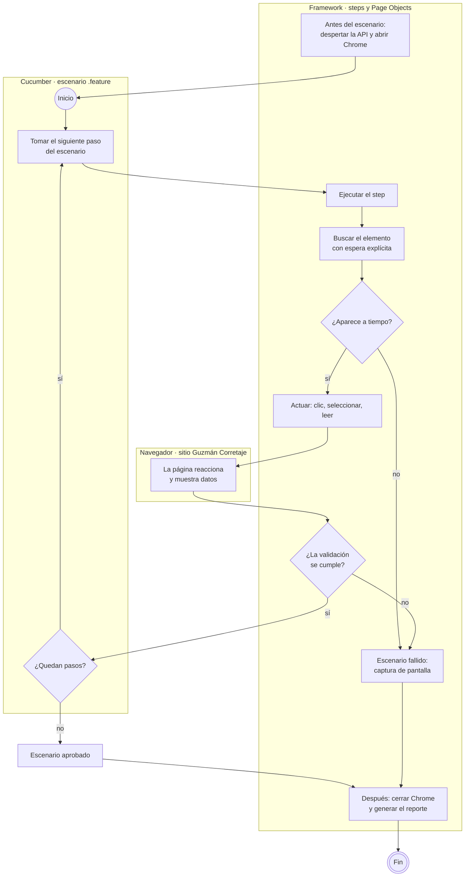
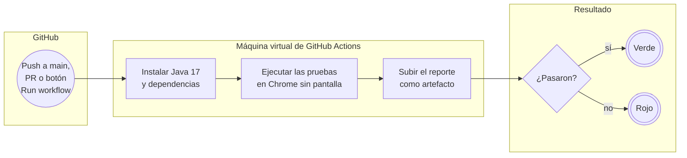

# Guzmán Corretaje — Selenium + Cucumber con fixtures de datos en Karate

> **Rama `feature/karate-fixtures`** · Todo lo de [`main`](https://github.com/pgp-qa-automation-labs/poc-selenium-cucumber/tree/main) + **fixtures que preparan los datos de prueba con Karate** antes de que el escenario de Selenium se ejecute. Es una prueba de concepto de cómo integrar **Karate, Selenium y Java** en el mismo proyecto.

## El patrón que demuestra esta rama

Antes de cada escenario, un **fixture** prepara los datos y decide si el escenario puede ejecutarse:

```
Examples (columna "perfil")
        │  la fila indica QUÉ datos necesita el escenario
        ▼
ClienteFixture
  1. Obtener datos        GeneradorDatos (Datafaker)        ← en un proyecto real: consulta a la base de datos
  2. Validar por API      Karate: registrar_cliente.feature ← envía los datos y evalúa un criterio
  3. ¿Cumple el criterio?
        sí → guarda el cliente en el TestContext y el escenario continúa con Selenium
        no → el escenario queda OMITIDO (skipped) con el motivo en el reporte
```

- **Karate y Cucumber conviven:** Cucumber ejecuta los features de `src/test/resources/features/` (UI con Selenium) y Karate los de `src/test/resources/karate/` (API). El fixture llama a Karate desde Java con `Runner.runFeature(...)`, le pasa los datos como variables y lee el resultado (`elegible` y `motivo`).
- **La configuración es una sola:** la URL de la API sale de `env_<ambiente>.json` (Java) y se pasa a Karate; no hay un `karate-config.js` paralelo.
- **Omitido no es fallido:** si los datos no cumplen el criterio, el escenario no corre y queda registrado por qué. Si Karate no alcanza a evaluar el criterio (un error técnico), el escenario **falla**, no se omite.
- **Por qué el fixture lo llama un paso y no un hook:** un hook `@Before` se ejecuta antes de los pasos y no puede leer los valores de `Examples`. El paso `Given` sí recibe el perfil de la fila y se lo entrega al fixture.

```gherkin
Scenario Outline: Un cliente <perfil> inicia sesión en el portal
  Given que existe un cliente "<perfil>" que cumple el criterio para iniciar sesión
  When inicia sesión con su usuario y contraseña
  Then ve el portal de clientes con su nombre

  Examples: Clientes que cumplen el criterio
    | perfil                 |
    | que quiere comprar     |
    | que consulta           |
    | que consulta arriendos |

  Examples: Cliente que no cumple el criterio (el escenario se omite)
    | perfil             |
    | sin consentimiento |
```

Resultado: **3 escenarios pasan** (registro por Karate + login por Selenium) y **1 queda omitido** con el motivo que devolvió la API: *HTTP 400 - Debes aceptar la Política de Privacidad para crear tu cuenta*.

**Notas técnicas**
- Se usa **Karate 1.5.2** porque funciona con **Java 17**; Karate 2.x exige Java 21.
- Karate trae **Logback**, por eso esta rama no usa `slf4j-simple`. En `logback-test.xml` los logs de Karate quedan en `WARN`, porque en `DEBUG` imprimen cada request, incluida la contraseña del cliente de prueba.
- El feature de Karate **no lleva `@ignore`**: Karate salta los features con esa etiqueta incluso cuando se invocan desde Java.
- Siguiente paso previsto: agregar la consulta a la base de datos (Supabase) como origen de datos, con un usuario de solo lectura y la credencial en variables de entorno.

---

## Lo que viene de `main`

## ¿Qué hace esta rama?

Abre un navegador y hace **exactamente lo que haría un cliente** en el sitio [Guzmán Corretaje](https://guzman-corretaje.vercel.app/), comprobando en cada paso que la página responda como se espera:

1. Entra al home y elige **Comprar**.
2. Filtra por **Departamento**, **Región Metropolitana** y **Ñuñoa**, y presiona **Buscar**.
3. Revisa que el listado tenga resultados y que **todas** las propiedades estén en Ñuñoa.
4. Abre la primera propiedad y verifica que el detalle muestre **el mismo título, ubicación, precio y código** que la tarjeta del listado, además de dormitorios y baños.

Además, prueba el **login de clientes** con los datos que prepara el fixture de Karate (ver [El patrón que demuestra esta rama](#el-patrón-que-demuestra-esta-rama)).

Si algo no se cumple, la prueba falla y deja una **captura de pantalla** del momento exacto del error.

El escenario está escrito en lenguaje de negocio ([`busqueda_propiedad.feature`](src/test/resources/features/busqueda_propiedad.feature)):

```gherkin
Scenario: Buscar un departamento en venta en Ñuñoa y revisar su detalle
  Given que el usuario está en el home de Guzmán Corretaje
  When selecciona la operación "Comprar"
  And filtra por tipo "Departamento", región "Región Metropolitana" y comuna "Ñuñoa"
  And presiona Buscar
  Then ve el listado "Propiedades en Venta" con al menos 1 resultado
  ...
```

## Ramas del repositorio

Cada rama agrega un nivel sobre la anterior:

| Rama | Qué agrega | IA |
|---|---|---|
| [`main`](https://github.com/pgp-qa-automation-labs/poc-selenium-cucumber/tree/main) | Automatización base: Selenium + Cucumber + TestNG con Page Object Model | No |
| [`feature/self-healing-ia`](https://github.com/pgp-qa-automation-labs/poc-selenium-cucumber/tree/feature/self-healing-ia) | **Self-healing:** si un elemento de la página cambia, la IA lo encuentra, la prueba continúa y se propone un PR que corrige el código | Sí (consulta directa) |
| [`feature/agentes-ia`](https://github.com/pgp-qa-automation-labs/poc-selenium-cucumber/tree/feature/agentes-ia) | **Agente de triage:** cuando una prueba falla, un agente investiga la causa y crea un issue en GitHub, Jira o Azure DevOps | Sí (agente) |
| **`feature/karate-fixtures`** (esta) | **Fixtures con Karate:** preparan y validan los datos por API antes del escenario de Selenium; si no cumplen el criterio, el escenario se omite | No |
| [`demo/locator-obsoleto`](https://github.com/pgp-qa-automation-labs/poc-selenium-cucumber/tree/demo/locator-obsoleto) | Rama de demostración del PR automático del self-healing | — |

## Cómo funciona

### 1. Flujo de la prueba

Cada paso del escenario pasa por el framework, que busca el elemento en la página (esperando a que aparezca), actúa sobre él y valida el resultado.



- **Esperas explícitas:** el framework espera hasta 10 s a que cada elemento aparezca, en lugar de pausas fijas. Así la prueba es rápida cuando el sitio responde rápido y tolera cuando tarda.
- **Despertar la API:** el backend de QA corre en un plan gratuito que se duerme. Antes de abrir el navegador se consulta la API hasta que responda, para que la prueba no falle por eso.

### 2. Flujo del pipeline (GitHub Actions)



## Paso a paso para usarlo

### En tu computador
1. **Instala** [Java 17](https://adoptium.net/), [Maven 3.9+](https://maven.apache.org/download.cgi), [Git](https://git-scm.com/) y Google Chrome. No necesitas descargar ChromeDriver: Selenium lo obtiene solo.
2. **Descarga el proyecto:**
   ```bash
   git clone https://github.com/pgp-qa-automation-labs/poc-selenium-cucumber.git
   cd poc-selenium-cucumber
   ```
3. **Ejecuta las pruebas** (se abrirá Chrome y verás la prueba avanzar sola):
   ```bash
   mvn test
   ```
4. **Revisa el resultado** abriendo en el navegador `target/cucumber-reports/cucumber.html`. Cada paso aparece en verde (aprobado) o rojo (fallido), con la captura de pantalla si algo falló.

### En GitHub, sin instalar nada
1. Entra a la pestaña **Actions** → **E2E Selenium Cucumber** → **Run workflow** → **Run workflow**.
2. Al terminar, abre la ejecución: verás si pasó (✅) o falló (❌) y en **Artifacts** podrás descargar el reporte.

### Opciones útiles
```bash
mvn test                              # ambiente qa (por defecto)
mvn test -Denv=dev                    # localhost (front :3000, API :5000)
mvn test -Denv=prod                   # producción (aún sin URL: falla con mensaje claro)
mvn test -Dbrowser.headless=true      # sin abrir ventana del navegador
mvn test -Dcucumber.filter.tags=@smoke
```

## Configuración

```
src/test/resources/config/
├── config.json               → valores comunes a todos los ambientes
└── environments/
    ├── env_dev.json          → localhost
    ├── env_qa.json           → QA (preproductivo)
    └── env_prod.json         → producción
```

- Los JSON contienen **solo datos**; cada `env_<env>.json` declara únicamente lo que cambia respecto de `config.json`.
- Toda la lógica (mezcla, reglas, overrides y validaciones) está en `ConfigReader.java`.
- Precedencia (el último gana): `config.json` → `env_<env>.json` → reglas por contexto (`CI=true` fuerza headless) → `-Dseccion.clave=valor`.
- **Ventana del navegador:** con navegador visible se maximiza; en headless (CI) usa el tamaño fijo `browser.windowWidth` × `browser.windowHeight`.

## Estructura

```
src/main/java/cl/guzman/automation/
├── config/        ConfigReader y EnvironmentConfig
├── driver/        DriverFactory y DriverManager (un navegador por hilo)
├── pages/         BasePage, HomePage, ResultadosPage, DetallePropiedadPage, LoginPage, PortalClientePage
├── components/    TarjetaPropiedad
├── model/         Propiedad, Cliente
└── utils/         TextUtils, ScreenshotUtils, WarmUpUtils, GeneradorDatos (Datafaker)

src/test/java/cl/guzman/automation/
├── context/       TestContext (estado compartido entre steps, vía PicoContainer)
├── fixtures/      ClienteFixture (prepara y valida el cliente con Karate) y PerfilCliente (perfiles de los Examples)
├── hooks/         Hooks (despertar API, abrir/cerrar navegador, captura al fallar)
├── runners/       TestRunner (TestNG)
└── steps/         NavegacionSteps, BusquedaPropiedadSteps, DetallePropiedadSteps, LoginSteps

src/test/resources/features/   escenarios Gherkin de UI (Cucumber + Selenium)
src/test/resources/karate/     features de API usados por los fixtures (Karate)
```

## Notas

- **Usuarios de prueba:** cada ejecución del login registra 3 clientes reales en el ambiente, con usuario que empieza por `qa_auto_` para identificarlos y limpiarlos desde la base. El backend limita los registros por IP: si se ejecuta muchas veces seguidas puede responder *429 Demasiados intentos*; en ese caso, espera unos minutos.
- Si tienes un `chromedriver.exe` antiguo en el PATH, Maven lo ignora (`SE_SKIP_DRIVER_IN_PATH=true` en el `pom.xml`). Si ejecutas desde el IDE sin Maven, define esa variable de entorno en la configuración de ejecución.
